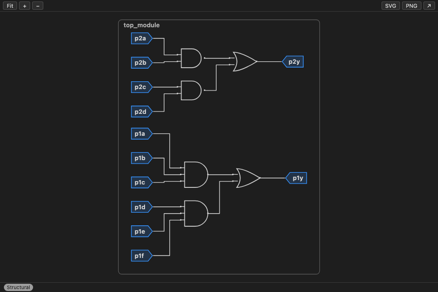

# RTL Live

[](https://github.com/vejaysuriyaa-07/rtl-live/actions/workflows/ci.yml)

A live Verilog schematic in the VS Code sidebar. The diagram redraws as you type, and once the file parses it is synthesized into real gates, with a legend and tooltips that explain every symbol in plain words.



## What it does

Open any `.v` or `.sv` file and the Schematic view draws it: ports left and right, gates, muxes, flip-flops, buses with widths, and wires that stay readable. While you type, a structural view keeps up with every keystroke and never goes blank on broken code. When the file parses, Yosys turns it into gates and the drawing becomes exact; an RTL/Gate toggle switches between a diagram shaped like the source and the optimized netlist. Hover anything for a one-sentence explanation and the source line it came from. Click a gate to jump to its code; move the cursor and the matching symbol lights up.

Built for learning Verilog on exercise sets like HDLBits: type a module header and the box appears, add an `assign` and the gate appears, make a mistake and the banner says what is missing and where.

## Install

From the Marketplace: search for "RTL Live" in the Extensions view. From a file: `code --install-extension rtl-live-0.5.1.vsix`, then "Developer: Reload Window".

It works out of the box with the built-in synthesis engine (Yosys compiled to WebAssembly, about 80 MB, loaded on first use). Installing a native Yosys makes synthesis several times faster:

| OS              | Install                                                                                                                                                      |
| --------------- | ------------------------------------------------------------------------------------------------------------------------------------------------------------ |
| macOS           | `brew install yosys`                                                                                                                                         |
| Ubuntu, Debian  | `sudo apt install yosys`                                                                                                                                     |
| Windows, any OS | [OSS CAD Suite](https://github.com/YosysHQ/oss-cad-suite-build/releases): unpack and put its `bin` folder on PATH, or set `rtlLive.yosysPath` to `yosys.exe` |

The extension looks for `yosys` in `rtlLive.yosysPath`, then on PATH, then in `/opt/homebrew/bin`, `/usr/local/bin`, `/usr/bin`, `~/.local/bin` and an `oss-cad-suite/bin` folder. "RTL Live: Show Tool Paths" prints what it found. Verilator is optional and only sharpens error messages.

## Features

- Structural view while typing: module box, ports with widths, wires, instances, and dashed "logic clouds" for `assign` and `always` blocks. Half-typed or broken code never blanks the view; ports recovered from a broken header stay visible, greyed.
- Two synthesized views. RTL view is shaped like the source: a `case` is one N:1 mux with inputs labelled by select value, `cond ? x : y` a 2:1 mux, `if (en)` on a flop an EN pin, a synchronous reset an R pin, word-level `+`, `==`, `<` single boxes. Gate view is what synthesis builds: enables and resets become muxes in front of plain flops.
- IEEE/ANSI gate symbols (AND, OR, XOR, NOT, BUF; NAND, NOR, XNOR with an output bubble), reduction gates, flip-flops with a clock triangle, latches with a warning badge, arithmetic and comparator boxes, constants, split and join rippers for bit-selects, part-selects, concatenation and replication.
- Logical operators drawn the way they work: `a || b` on buses goes through "any 1?" boxes into a plain 1-bit OR tagged "logical"; `!a` on a bus is one "all 0?" box.
- Every element explains itself on hover and quotes its source line: wires, junction dots ("Wires connect here"), plain crossings ("These wires cross but do not connect"), bubbles, pins, bus slashes, ripper labels, gates, muxes, flip-flops, latches, constants, instances and black boxes. An output nothing drives yet says "not driven yet".
- Legend (key `l`): every symbol with its meaning, drawn with the diagram's own symbols.
- Focus mode: hover a wire or a symbol to light its whole net and fade the rest; Escape clears.
- Readable layout: wires of different nets stay apart, fan-out trunks get their own channels, pins sit on a fixed pitch, junction dots are clearly larger than the wire and never sit on a crossing, bus labels sit above their own slice wires. A 100-node diagram renders in under 16 ms.
- Warnings on the wire: multiply driven bits (`y[3:2] has multiple drivers`) and combinational loops carry a badge and name the signal.
- Hierarchy: instances of modules in the same file are boxes you can double-click to drill into, with a breadcrumb back. Modules not in the file are dashed black boxes with pin directions inferred from how they are connected.
- Syntax errors say what is missing and where, in beginner terms: `missing ';'`, `missing ')' to close the port list`, `assign is incomplete: write assign name = expression;`, `missing endmodule`. Every error after the first is listed too.
- Status badge: Structural, Editing, RTL view, Gate view or Stale (the last good diagram with changed ports overlaid). Its tooltip names the synthesis engine and where it runs from.
- Export SVG and PNG: dark lines on white with a margin and safe fonts, ready for a document; `rtlLive.exportPalette: theme` keeps the editor colours. "Open in Editor Panel" shows the diagram in a full tab.
- Design: symbols in the editor foreground, one accent for ports and junction dots, calm fills, rounded wire bends, monospace labels. High contrast themes get 2 px borders and no fills. Transitions respect reduced-motion.
- Keys inside the view: `f` fit, `+`/`-` zoom, `l` legend, `Escape` clear focus or close the legend, `Backspace` drill up.

More screenshots in `media/screenshots/`: `module_add.png` (hierarchy), `vectorgates-logical.png` (logical OR), `legend-dark.png`, `focus-mode.png`, `before-after.png`, `contact-sheet.png` (every fixture at a glance).

## Settings

| Setting                        | Default | Meaning                                                                                                                            |
| ------------------------------ | ------- | ---------------------------------------------------------------------------------------------------------------------------------- |
| `rtlLive.synthesisBackend`     | `auto`  | `auto` uses native Yosys when one answers `yosys -V`, else the built-in engine; `native`, `wasm`, or `off` (structural view only). |
| `rtlLive.yosysPath`            | `""`    | Path to a native yosys binary (`yosys.exe` on Windows). Empty searches PATH and the common folders listed above.                   |
| `rtlLive.verilatorPath`        | `""`    | Path to a verilator binary. Empty searches PATH and the common folders.                                                            |
| `rtlLive.lintWithVerilator`    | `true`  | When the file does not parse or synthesis fails and Verilator is available, run `verilator --lint-only` to sharpen the message.    |
| `rtlLive.yosysExtraPasses`     | `""`    | Extra passes inserted before `write_json`, separated by semicolons.                                                                |
| `rtlLive.optimize`             | `false` | Runs `opt -fast` before writing the netlist (smaller diagram, further from the source text).                                       |
| `rtlLive.bubbles`              | `true`  | Draw a NOT that feeds a single gate as an inversion bubble on that gate.                                                           |
| `rtlLive.structuralDebounceMs` | `60`    | Delay between a keystroke and the structural update.                                                                               |
| `rtlLive.synthDebounceMs`      | `300`   | Delay after the last keystroke before synthesis runs.                                                                              |
| `rtlLive.exportPalette`        | `print` | Colours of exported files: `print` is dark lines on white with a margin; `theme` keeps the editor colours.                         |

Settings apply live.

## Known limitations

- One file at a time: the module hierarchy is read from the active file. Modules defined elsewhere are drawn as black boxes.
- SystemVerilog is parsed with the Verilog grammar; interfaces, packages, classes and most `generate` loops are not drawn.
- Memories appear as one `$mem` box; no simulation, no waveforms, no technology mapping, no graphical editing.
- Files above 2,000 synthesized cells show the structural view only.
- The structural view is a sketch of the text, not a netlist: it is replaced by the synthesized view as soon as the file parses.

## Privacy

No telemetry, no network. Synthesis runs on your machine, in the extension host or in a native Yosys process you installed. Nothing leaves VS Code.

## Troubleshooting

- "Warming up synthesis engine" for a long time: the built-in engine loads about 80 MB on first use. Install Yosys for a native engine, or wait once; it is cached afterwards.
- The badge says Stale: the file has a syntax error (the banner shows it) or synthesis has not caught up. The last good diagram stays on screen.
- "Using the built-in engine" notice: no native Yosys answered `yosys -V`. Run "RTL Live: Show Tool Paths" to see what was searched and skipped, then install Yosys or set `rtlLive.yosysPath`.
- Nothing appears: the file must end in `.v`, `.vh`, `.sv` or `.svh`, or have the Verilog or SystemVerilog language mode. An untitled Plain Text file that looks like Verilog gets a one-click "Set language to Verilog".
- The view is blank (no toolbar): run "RTL Live: Show Log". A healthy start logs `sidebar webview script ...`, `[webview] webview booting (vscode api)` and `sidebar webview ready`; a `failed to load ...` line names the broken resource. "Developer: Open Webview Developer Tools" shows the same errors in a console.
- A dashed box labelled with a `$...` cell type: a Yosys cell this version does not draw yet; it is logged once in the output channel.
- Layout looks wrong after a theme change: run "RTL Live: Fit to View" or press `f` in the view.

## Architecture

```
editor text --(60 ms)--> structural layer (web-tree-sitter + tree-sitter-verilog wasm,
                          fallback scanner) --> IR (structural) --> webview
            --(300 ms, clean tree only)--> synthesis layer (native yosys or @yowasp/yosys
                          in a worker_threads worker, one script per view) --> write_json --> fromYosys
                          --> rtlView (RTL view only) --> simplify --> semantics --> IR --> webview
webview: IR --> ELK (layered, Web Worker from a Blob URL) --> SVG symbols, d3-zoom
```

- `src/structural/`: error-tolerant parsers that share one `StructuralFile` model; `toIr.ts` builds the structural IR.
- `src/synth/`: Yosys script, black-box stubs, tool lookup, native and wasm backends, the worker entry.
- `src/ir/`: shared IR types, `fromYosys.ts` (bit-level net reconstruction with split/join/const nodes), `rtlView.ts` (case muxes by select value), `simplify.ts` (gate chain merging, buffer removal, inversion bubbles), `semantics.ts` (multiple drivers, combinational loops), `overlay.ts` (stale port overlay), `toVerilog.ts` (netlist export for the equivalence check), stable ids.
- `src/extension/`: scheduler with per-document generations, synthesis manager with an LRU cache, controller, webview provider with a strict CSP.
- `webview/`: layout (`toElk.ts`, junction post-pass), SVG renderer and symbols on design tokens, zoom, cursor highlight, focus, export, toolbar, status, banner, breadcrumb, legend.

See NOTES.md for decisions, measurements and known issues, and docs/ACCURACY.md for what each view promises.

## Development

```
npm install
npm run build:grammar  # builds assets/wasm/tree-sitter-verilog.wasm (needs network once)
npm run build
npm test               # vitest unit, golden and accuracy (native yosys if found, else wasm)
npm run test:integration
npm run test:webview   # playwright; writes artifacts/contact-sheet.png and the layout shots
npm run test:packaged  # packages a vsix and runs the integration suite against the unzipped copy
npm run test:accuracy:update  # rewrite the accuracy baseline after an intended change (review the diff)
npm run test:perf      # render budget: a 100-node diagram in under 16 ms (runs alone, timing)
npm run test:mutation  # Stryker: how many injected bugs the suites catch (hours; reports in artifacts/mutation/)
npm run bench
npm run package        # rtl-live-<version>.vsix
```

`RTL_LIVE_TEST_BACKEND=wasm npm test` forces the built-in engine, which is what CI uses on every OS; the Ubuntu job also runs the native engine. The equivalence check (accuracy L1) needs Icarus Verilog and is skipped when it is not installed. `RTL_LIVE_YOSYS=off npm run test:integration` hides an installed Yosys from the extension's lookup, to rehearse a machine without one (`RTL_LIVE_IVERILOG=off` does the same for Icarus). CI runs on Ubuntu, macOS and Windows (`.github/workflows/ci.yml`).

## Credits

Yosys and YoWASP (ISC), web-tree-sitter and tree-sitter-verilog (MIT), elkjs (EPL-2.0), d3 (ISC), codicons (CC-BY-4.0). The split/join net reconstruction follows the approach of netlistsvg (MIT). See THIRD_PARTY_NOTICES.md.

## License

MIT
